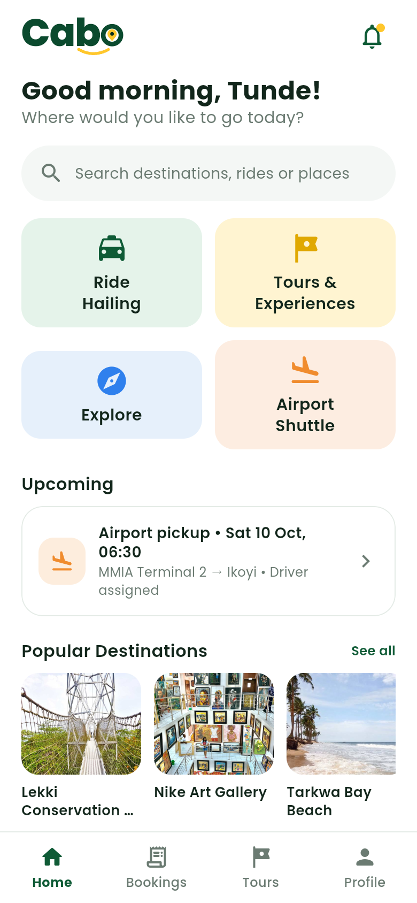
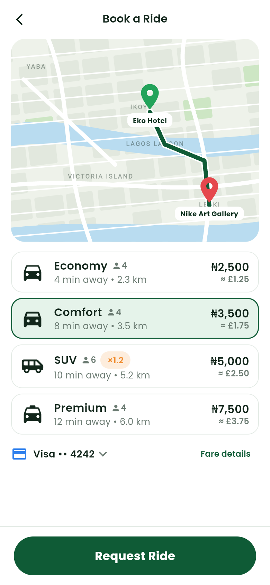
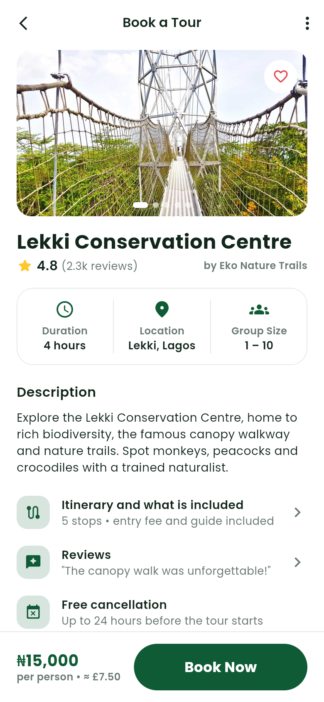

# Cabo Guest App

Mobile app (iOS and Android) for tourists, visitors and residents to book rides, airport shuttles, tours and attraction tickets, plan trips and pay.

The app runs on the Cabo backend at `https://controlpanel.caboapp.online/api/v1`. Guests sign in with a code sent to their phone or email, and everything they see and do goes through the API: tours and attractions, ride prices, bookings, the live trip, wallet, saved places, trusted contacts, support tickets and notifications. Nothing is sample data.

**Rides only go to tourism locations.** When a guest chooses a destination (or adds a stop), the list is the attractions from the API (`GET /places?kind=attraction`), and nothing else can be picked. The backend enforces the same rule, so a ride to anywhere else is refused. The pickup point can be anywhere: the guest's location, a saved place or a known landmark.

<p>
  
  
  
  
</p>

Screenshots of all screens are in [`screenshots/guest/`](../screenshots/guest). They were taken from the earlier design prototype, so the names and prices in them are sample data, not what the live app shows. File names follow the section numbering in `lib/routes.dart`, so `03-04-choose-a-ride.png` is screen 3.4.

## Run it

```sh
cd guest-app
flutter pub get
flutter run            # on a connected device or emulator, against the live backend
flutter test           # every screen, against responses recorded from the backend
```

To point a build at another server, such as a local `php artisan serve`:

```sh
flutter run --dart-define=API_BASE_URL=http://10.0.2.2:8000/api/v1   # Android emulator to your computer
```

### Signing in

Sign-in codes are not sent by SMS yet. While the backend has `CABO_DEMO_OTP=123456` in its `.env`, the code is always `123456` and the app shows it on the code screen. Email codes are sent by email once the backend has mail set up and the demo code is turned off. See the backend README.

### Tests

- `test/screens_test.dart` opens every screen with a fake API that replays responses recorded from the backend (`test/fixtures/api.json`), and checks the main flows: session restore, sign-in, and that destinations are limited to tourism locations.
- `test/live_api_test.dart` signs in, prices and books a ride to a tourism location and cancels it, against a real backend. It is skipped unless you name one:
  ```sh
  flutter test test/live_api_test.dart --dart-define=LIVE_API=http://127.0.0.1:8000/api/v1
  ```

GitHub Actions runs the tests and builds a release APK on every push that changes this folder (see the root README).

## Layout

| Path | What's there |
| --- | --- |
| `lib/routes.dart` | Every screen with its section number and route |
| `lib/screens/` | One file per section: onboarding, home, ride, shuttle, tours, explore, wallet, safety, bookings, profile, system |
| `lib/widgets/` | Shared pieces: buttons, cards, the logo, the painted map, destination photos and their fallback illustrations, bottom navigation |
| `assets/photos/` | Destination photos and their credits |
| `lib/api/` | The API client, sign-in token storage and device location |
| `lib/state/app_state.dart` | The signed-in guest, the ride being booked, the live trip and items picked on one screen for the next |
| `lib/widgets/live.dart` | Loading, error and retry handling shared by every screen |
| `lib/format.dart` | Naira, date and time formatting |
| `lib/config.dart` | The backend address |
| `lib/theme.dart` | Brand colours and text styles |
| `tool/screenshots.js` | Regenerates `screenshots/guest/` |

## Regenerating screenshots

```sh
flutter build web --release --no-web-resources-cdn --dart-define=SCREENSHOT_MODE=true
npm install --no-save playwright && npx playwright install chromium
node tool/screenshots.js build/web ../screenshots/guest
```

## Not done yet

These screens say so in the app rather than showing made-up data:

- **Chat with the driver**, **saved cards**, **Google and Apple sign-in**, **events**, **push notifications** and **app text in other languages**. The backend has nothing for these yet.
- **Payments.** The backend records charges, top-ups and refunds but is not connected to a payment provider, so no money moves.
- **Maps** are drawn by the app (`lib/widgets/map.dart`) as a stand-in for Google Maps or Mapbox, so pins are not at real positions. Distances and prices are real: they come from the backend.
- **Photos**: tours and attractions use the image the backend gives, and fall back to the bundled photos in `assets/photos/` (credits in `assets/photos/CREDITS.md`).
- **Launcher icon** is still the Flutter default.
- **Release signing**: CI builds are signed with the debug key.
