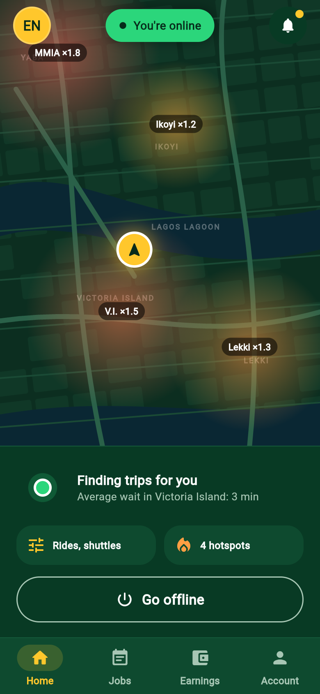
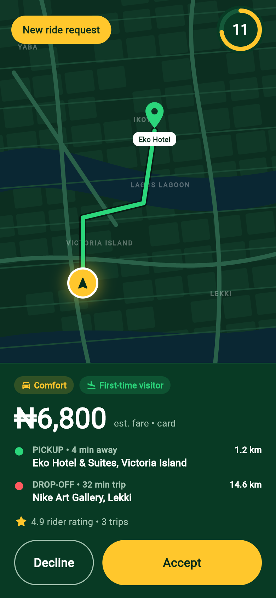
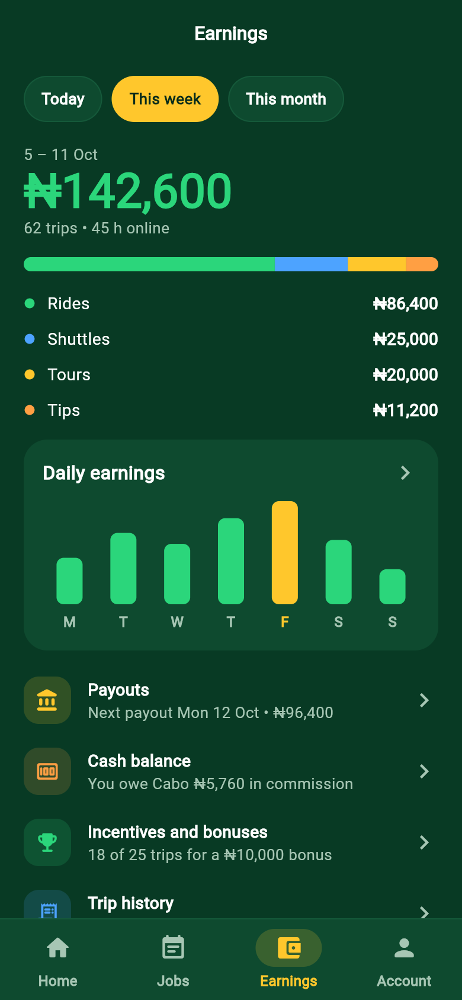

# Cabo Host App

Mobile app (Android first, then iOS) for drivers and driver-guides to receive and complete rides, shuttles and tour jobs, and track earnings.

The app runs on the Cabo backend at `https://controlpanel.caboapp.online/api/v1`. Hosts sign in with a code sent to their phone, and everything goes through the API. Nothing is sample data.

- **Applying**: personal details, host type, documents photographed or chosen from the gallery and uploaded, vehicle, background check consent, bank details, then submitting the application and following its review.
- **Going online**: the app sends the phone's position, keeps it updated every 20 seconds, and explains what is missing if the account cannot go online yet.
- **Rides**: nearby requests appear on the home screen within about 5 seconds. Accept or decline, navigate to the pickup in the phone's maps app, mark arrival, start the trip with the rider's 4-digit PIN, complete it, collect cash and rate the rider. If the rider cancels, the app says so and returns home.
- **Jobs**: open airport shuttles to accept and run, and tours to guide with a guest list and ticket check-in.
- **Earnings**: today, week and month totals, daily chart, trip history, payouts, instant cash-out and the cash commission balance.
- **Performance, safety and support**: ratings and feedback, SOS alert to Cabo, incident and found-item reports, support tickets with replies, notifications.

<p>
  
  
  
  
</p>

Screenshots of all screens are in [`screenshots/host/`](../screenshots/host). They were taken from the earlier design prototype, so the names and amounts in them are sample data, not what the live app shows. File names follow the spec numbering, so `03-06-trip-in-progress.png` is screen 3.6.

## Run it

```sh
cd host-app
flutter pub get
flutter run            # on a connected Android device or emulator, against the live backend
flutter test           # every screen, against responses recorded from the backend
```

To point a build at another server, such as a local `php artisan serve`:

```sh
flutter run --dart-define=API_BASE_URL=http://10.0.2.2:8000/api/v1   # Android emulator to your computer
```

### Signing in

Sign-in codes are not sent by SMS yet. While the backend has `CABO_DEMO_OTP=123456` in its `.env`, the code is always `123456` and the app shows it on the code screen. A new phone number starts a new application; the sample database has approved hosts such as `+234 801 234 5679`.

### Tests

- `test/screens_test.dart` opens every screen with a fake API that replays responses recorded from the backend (`test/fixtures/api.json`), and checks sign-in, going online, accepting a request and starting a trip with the PIN.
- `test/live_api_test.dart` runs a whole ride against a real backend from both sides: a guest requests it, the host accepts, arrives, starts it with the PIN, completes it, collects cash and rates the rider. It is skipped unless you name a backend:
  ```sh
  flutter test test/live_api_test.dart --dart-define=LIVE_API=http://127.0.0.1:8000/api/v1
  ```

GitHub Actions runs the tests and builds a release APK on every push that changes this folder (see the root README).

## Layout

| Path | What's there |
| --- | --- |
| `lib/routes.dart` | Every screen with its spec number and route |
| `lib/screens/` | One file per spec section: onboarding, home, trips, jobs, earnings, performance, safety, account, system |
| `lib/widgets/` | Shared pieces: buttons, cards, the logo, the painted map, charts, bottom navigation |
| `lib/api/` | The API client, sign-in token storage and device location |
| `lib/state/app_state.dart` | The signed-in host, online status, nearby requests and the trip in hand |
| `lib/widgets/live.dart`, `documents.dart` | Loading and error handling; document tiles and photo upload |
| `lib/config.dart` | The backend address |
| `lib/theme.dart` | Brand colours and text styles |
| `assets/fonts/` | Poppins, plus a small Noto Sans subset for the naira sign (₦) |
| `tool/screenshots.js` | Regenerates `screenshots/host/` |

## Regenerating screenshots

The screenshots come from a web build of the same code, with timers and looping animations turned off so they look the same every run:

```sh
flutter build web --release --no-web-resources-cdn --dart-define=SCREENSHOT_MODE=true
npm install --no-save playwright && npx playwright install chromium
node tool/screenshots.js build/web ../screenshots/host
```

## Not done yet

These screens say so in the app rather than showing made-up data:

- **Chat with the rider**, **incentives and quests**, **referral rewards**, **in-app training videos and quiz scores**, **push notifications and request sounds**, **app text in other languages**. The backend has nothing for these yet.
- **Requests arrive only while the app is open**, because there are no push notifications yet.
- **Inspection booking, training and tour guide certification** are recorded by the Cabo team in the admin panel; the app shows their status.
- **Deleting an account** sends a request to support, because the balance has to be settled first.
- **Guide pay for tours** is not in the backend, so the tour summary does not show an amount.
- **Maps** are drawn by the app (`lib/widgets/map.dart`) as a stand-in, so pins are not at real positions. The Navigate button opens real directions in the phone's maps app.
- **Launcher icon** is still the Flutter default.
- **Release signing**: CI builds are signed with the debug key, which is fine for test phones but not for the Play Store.
