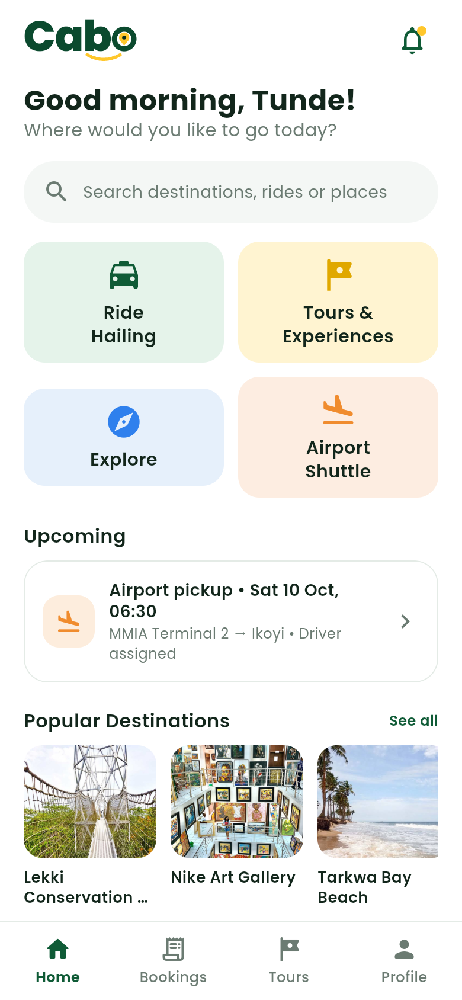
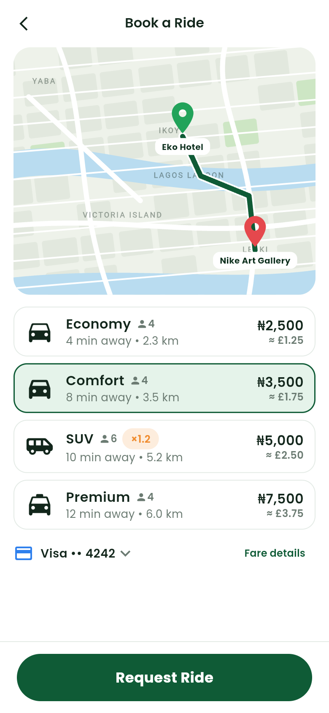
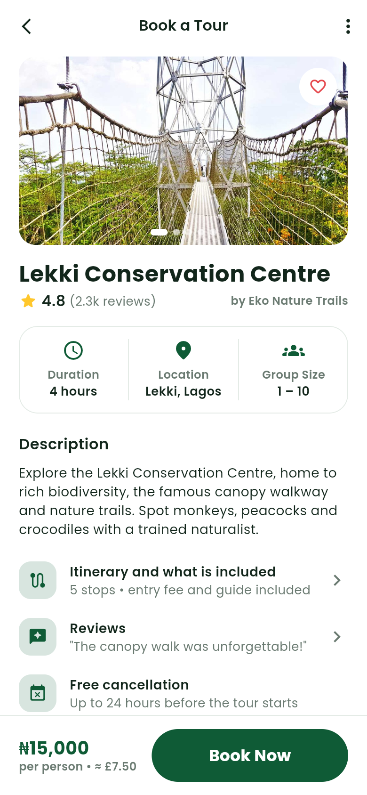

# Cabo Rider App

Mobile app (iOS and Android) for tourists, visitors and residents to book rides, airport shuttles, tours and attraction tickets, plan trips and pay.

This is a clickable prototype of the rider app, built from the PRD's rider requirements and the rider mockups. It uses sample data and has no backend yet. Buttons move through the real flows: sign-up, booking and taking a ride, airport pickups, finding and booking a tour, exploring attractions, paying and getting help. **Profile → All screens** lists every screen so you can jump straight to one.

<p>
  
  
  
  
</p>

Screenshots of all screens are in [`screenshots/rider/`](../screenshots/rider). File names follow the section numbering in `lib/routes.dart`, so `03-04-choose-a-ride.png` is screen 3.4.

## Run it

```sh
cd rider-app
flutter pub get
flutter run            # on a connected device or emulator
flutter test           # every screen renders at phone size without layout overflow
```

GitHub Actions runs the tests and builds a release APK on every push that changes this folder (see the root README).

## Layout

| Path | What's there |
| --- | --- |
| `lib/routes.dart` | Every screen with its section number and route |
| `lib/screens/` | One file per section: onboarding, home, ride, shuttle, tours, explore, wallet, safety, bookings, profile, system |
| `lib/widgets/` | Shared pieces: buttons, cards, the logo, the painted map, destination photos and their fallback illustrations, bottom navigation |
| `assets/photos/` | Destination photos and their credits |
| `lib/data.dart` | Sample places and tours, plus naira and home-currency formatting |
| `lib/theme.dart` | Brand colours and text styles |
| `tool/screenshots.js` | Regenerates `screenshots/rider/` |

## Regenerating screenshots

```sh
flutter build web --release --no-web-resources-cdn --dart-define=SCREENSHOT_MODE=true
npm install --no-save playwright && npx playwright install chromium
node tool/screenshots.js build/web ../screenshots/rider
```

## Not done yet

- **Photos**: destinations and tours use photos from `assets/photos/` (credits and notes in `assets/photos/CREDITS.md`). The accessible van still uses an illustration until a photo is added; any missing photo falls back to the illustration in `lib/widgets/scenes.dart`.
- **Maps** are drawn by the app (`lib/widgets/map.dart`) as a stand-in for Google Maps or Mapbox.
- **Data** is hard-coded sample data until the backend exists. Home-currency amounts use a fixed sample rate.
- **Launcher icon** is still the Flutter default.
- **Release signing**: CI builds are signed with the debug key.
